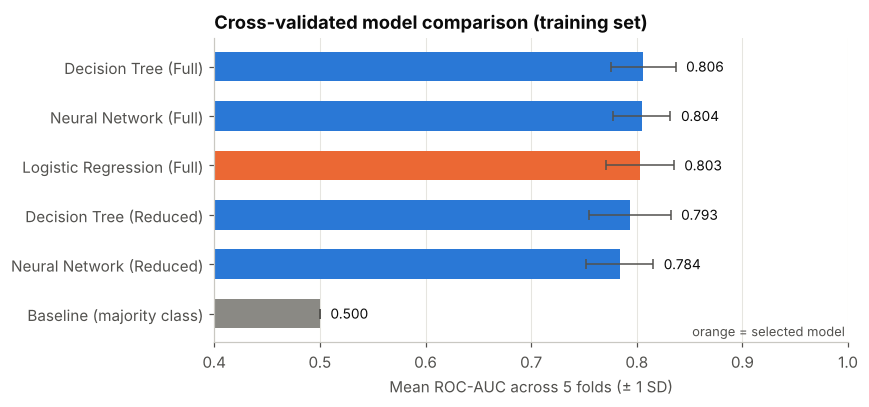
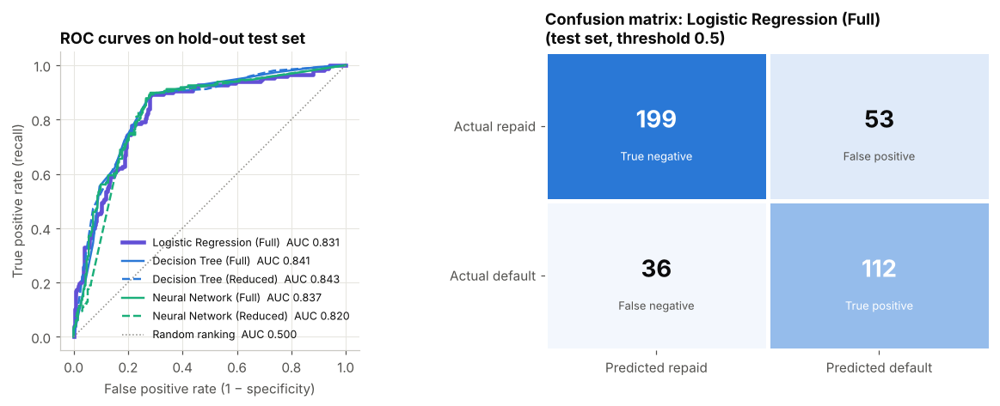
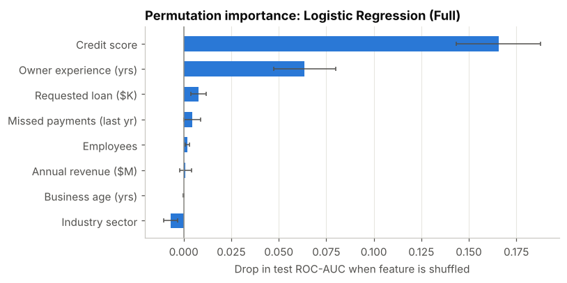
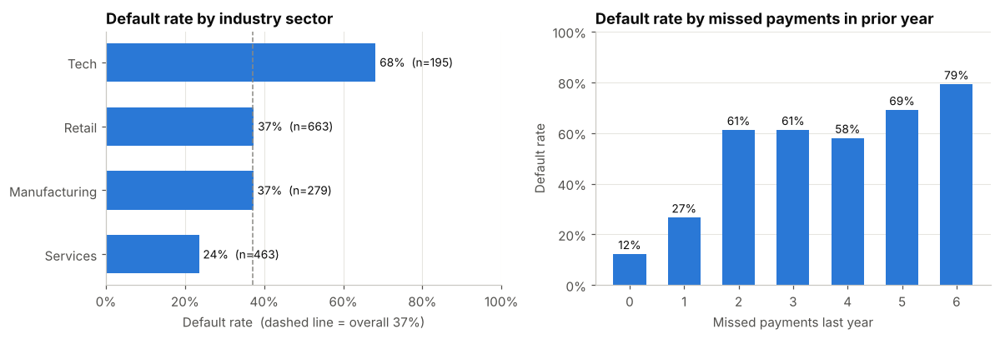
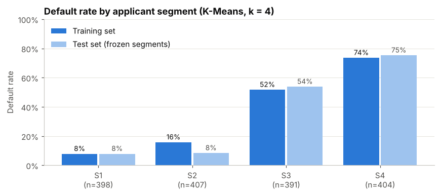
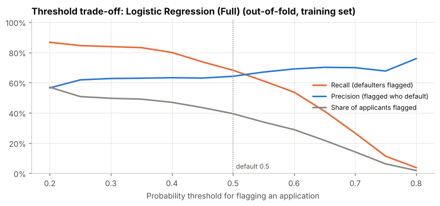

# Loan Default Risk Prediction
### Executive Analytical Report

**Author:** Ahmed Alazzawi · University of South Florida
**Scope:** Predicting small-business loan default from application-time information
**Status:** Analytical prototype — corrected, re-executed and verified (not validated for production use)

---

## Executive summary

- **Default risk can be ranked well from application data alone.** The selected model ranks a randomly chosen defaulter above a randomly chosen repayer about 83% of the time on held-out data (**test ROC-AUC 0.831**, 95% CI 0.784–0.873), versus 50% for no model.
- **A simple, explainable model is enough.** Logistic Regression, a Decision Tree and a Neural Network performed the same within statistical noise (cross-validated ROC-AUC 0.803–0.806), so the most transparent model was selected under a rule fixed before results were seen.
- **Two signals carry most of the information:** credit score, and the owner's years of experience. Other attributes add little once these are known.
- **Applicants fall into four clear segments** whose default rates range from 8% to 74%, and those rates hold on unseen data.
- **How many applications to review is a policy choice.** At the default setting the model sends 39% of applications to review and catches 68% of eventual defaulters; a lower threshold sends 50% and catches 84%.
- **The original course submission contained a target-leakage error** in its clustering step. It has been removed; it turned out not to inflate the original scores, and the corrected results are of similar size, now confirmed on a hold-out test set.

---

## 1. Business question

A lender receives small-business loan applications and has limited analyst time. The question is whether the information collected at application can identify which applicants are most likely to default, so that review effort goes where risk is highest.

The analysis delivers three things: a risk score for each applicant, an explanation of what the score relies on, and a description of natural applicant segments. It identifies **associations** in historical data; it does not show that any attribute *causes* default.

## 2. Data and approach

| | |
|---|---|
| **Data** | 2,000 anonymised small-business loan applications (course-supplied); 37.1% defaulted |
| **Predictors** | Business age, annual revenue, employees, industry sector, credit score, missed payments in prior year, owner experience, requested loan amount |
| **Quality** | No missing values or duplicates; values in plausible ranges; large-revenue outliers judged genuine and retained |
| **Validation design** | 80% training (1,600) / 20% untouched test (400), split before any modelling; 5-fold cross-validation on the training set for model selection |
| **Models compared** | Majority-class baseline, Logistic Regression, Decision Tree, Neural Network; Full (8 features) and Reduced (4 features) versions |
| **Selection rule** | Highest cross-validated ROC-AUC; within 0.01, prefer the more interpretable model |

**Why ROC-AUC?** The business use is to *rank* applications by risk. ROC-AUC measures ranking quality independently of where the review cut-off is set, which is a separate business decision (Section 5).

**Leakage controls.** The outcome is never used as an input — including in segmentation. All scaling and encoding is learned inside each cross-validation fold, and the test set was used exactly once, after the model had been chosen.

## 3. Model performance

**Cross-validation on the training set** (mean of 5 folds; used to choose the model)

| Model | ROC-AUC | Accuracy | Precision | Recall | Specificity | F1 |
|---|---|---|---|---|---|---|
| Baseline (majority class) | 0.500 | 0.629 | 0.000 | 0.000 | 1.000 | 0.000 |
| **Logistic Regression (Full)** ✔ | **0.803** | 0.741 | 0.644 | 0.682 | 0.775 | 0.661 |
| Decision Tree (Full) | 0.806 | 0.748 | 0.649 | 0.700 | 0.776 | 0.673 |
| Decision Tree (Reduced) | 0.793 | 0.742 | 0.641 | 0.695 | 0.769 | 0.666 |
| Neural Network (Full) | 0.804 | 0.748 | 0.647 | 0.719 | 0.764 | 0.679 |
| Neural Network (Reduced) | 0.784 | 0.747 | 0.630 | 0.781 | 0.727 | 0.697 |

Fold-to-fold standard deviation of ROC-AUC is about 0.03 for every model, so the 0.003 spread among the three Full models is not meaningful. Logistic Regression was selected as the most interpretable of the three. The Reduced (four-feature) models rank risk less well because they omit owner experience.

**Hold-out test set** (400 applications; selected model is the headline result)

| Model | ROC-AUC | Accuracy | Precision | Recall | Specificity | F1 |
|---|---|---|---|---|---|---|
| **Logistic Regression (Full)** ✔ | **0.831** | 0.778 | 0.679 | 0.757 | 0.790 | 0.716 |
| Decision Tree (Full) | 0.841 | 0.780 | 0.695 | 0.723 | 0.813 | 0.709 |
| Decision Tree (Reduced) | 0.843 | 0.773 | 0.682 | 0.723 | 0.802 | 0.702 |
| Neural Network (Full) | 0.837 | 0.775 | 0.667 | 0.784 | 0.770 | 0.720 |
| Neural Network (Reduced) | 0.820 | 0.783 | 0.656 | 0.865 | 0.734 | 0.746 |

The selected model correctly flagged **112 of 148** test defaulters and wrongly flagged **53 of 252** repaying applicants (threshold 0.5). Test scores are a little higher than cross-validation scores; this is ordinary sampling variation in a 400-row test set, and every model's test ROC-AUC falls inside the selected model's 95% interval (0.784–0.873). The cross-validated level (≈0.80) is the more conservative expectation.

## 4. What is associated with default risk

**Credit score dominates; owner experience is second.** Randomly shuffling credit score reduces the selected model's test ROC-AUC by 0.166, and owner experience by 0.064. Every other attribute reduces it by less than 0.01. The Decision Tree tells the same story: its first split is a credit score of 702 — applicants at or below that score defaulted at 63% in training, versus 12% above it.

**Missed payments matter, but overlap with credit score.** Default rates climb from 12% for applicants with no missed payments to 61% with two (training data). Because missed payments and credit score are strongly correlated (r = −0.79), the model gains little from missed payments once credit score is known.

**Industry sector is a proxy, not a driver, in this data.** Tech applicants default at 68% versus 37% overall, but they are concentrated among young businesses with weak credit. Once those attributes are accounted for, sector adds no predictive value.

**Four applicant segments.** Clustering on application attributes alone (the outcome was not used) produced four well-separated groups (silhouette 0.560):

| Segment | Typical applicant (training medians) | Default rate: training | Default rate: test |
|---|---|---|---|
| S1 — Established | 20-year-old business, $3.25M revenue, credit 780, no missed payments | 8% | 8% |
| S2 — Young, strong credit | 5-year-old business, $203K revenue, 3 staff, credit 800 | 16% | 8% |
| S3 — Mid-size, weaker credit | 58 staff, credit 621, 2 missed payments | 52% | 54% |
| S4 — New, inexperienced, poor credit | 1.5-year-old business, owner experience 1.9 years, credit 602, 4 missed payments; 48% Tech | 74% | 75% |

## 5. Business implications

**Use the score to prioritise review, not to decide.** With test ROC-AUC around 0.83, the model is a reasonable triage tool for ordering an analyst's queue. It is not accurate enough, nor sufficiently validated, to approve or decline applications automatically.

**Choose the review threshold deliberately.** The trade-off below comes from out-of-fold predictions on the training data, so the test set played no part in it.

| Threshold | Share of applications sent to review | Share of defaulters caught | Share of flagged who default |
|---|---|---|---|
| 0.30 | 50% | 84% | 63% |
| 0.40 | 47% | 80% | 63% |
| 0.50 (default) | 39% | 68% | 64% |
| 0.60 | 29% | 54% | 69% |
| 0.70 | 14% | 27% | 70% |

A lower threshold catches more defaulters at the cost of more reviews. The right setting depends on the cost of a missed default compared with the cost of an extra review; those costs should come from the lender and are not assumed here.

**Prefer explainability when performance is tied.** Logistic Regression matched the more complex models while offering clear direction-of-effect coefficients that underwriters and auditors can examine — an advantage in regulated lending, where decisions may need to be explained to applicants.

**The workflow transfers.** The same disciplined process — define the decision, confirm what is known at decision time, separate training from testing, pre-commit to a selection rule and report uncertainty — applies directly to other operational and experience-analytics problems, such as prioritising service follow-ups.

## 6. Limitations and next steps

| Limitation | Implication | Recommended next step |
|---|---|---|
| Dataset source and period undocumented; structure suggests it may be synthetic | Results may not transfer to real portfolios | Confirm provenance; re-run on real lending data |
| Timing of `MissedPaymentsLastYear` assumed to precede the application | If recorded later, it would leak outcome information | Confirm field definition with the data owner |
| Small sample (400-row test set) | Test ROC-AUC uncertain by about ±0.045 | Validate on more data |
| Random, not time-based, split | Performance under changing economic conditions unknown | Out-of-time validation on later applications |
| Original hyper-parameters kept, no tuning | Tree and network may be slightly under-fitted | Tune inside cross-validation, then re-test on fresh data |
| Calibration, fairness and reject inference not assessed | Probabilities may be mis-scaled; disparate impact untested; declined applicants absent | Calibration check; fair-lending review; reason codes before any operational use |

## Appendix: corrections made to the original analysis

| Original issue | Correction |
|---|---|
| The outcome (`Defaulted`) was an input to K-Means, and each run's cluster labels fed the next run | Clustering uses application attributes only, fitted on training data |
| Those cluster labels were used as predictors | Removed from all models |
| Scaling fitted on all data before cross-validation | All preprocessing inside per-fold pipelines |
| No hold-out test; winner chosen on a 0.002 ROC-AUC gap | 80/20 split, pre-declared selection rule, single test evaluation with confidence interval |
| "Probability Measure" and "Entropy" reported as performance metrics, though neither measures model quality | Replaced with standard metrics and a confusion matrix |
| Reduced feature set described as importance-based without evidence | Described as a simplicity trade-off; shown to cost some performance |
| Student ID used as random seed; personal cloud-drive paths | Neutral seed (42); relative paths |

Re-running the original code showed the leak did not raise the original model scores (the Decision Tree never used the leaked columns), but it invalidated the original segmentation statistics. All figures in this report are from the corrected notebook (`Loan_Default_Risk_Prediction.ipynb`) and `results/metrics.json`.
